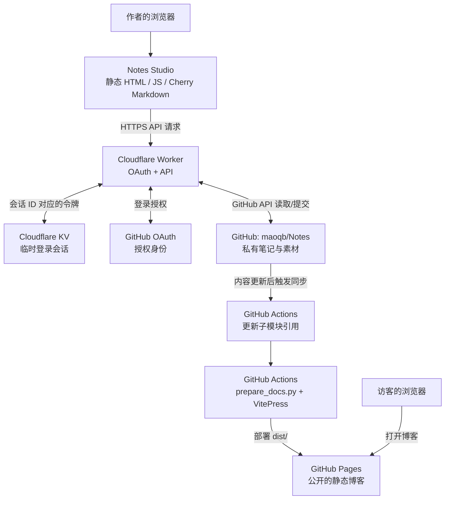
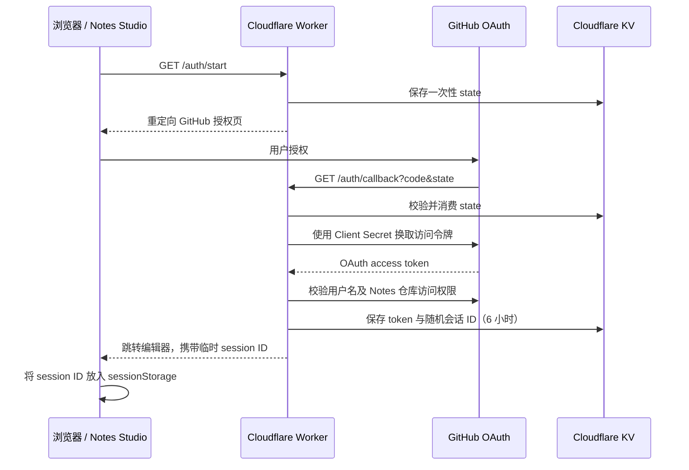
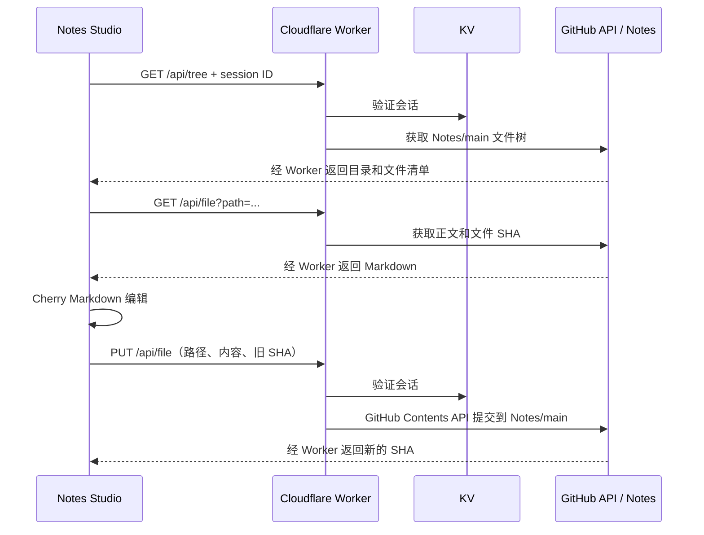

# Android Framework · AOSP Docs

这是一个记录 Android / AOSP Framework 源码学习笔记的个人博客。阅读站点和写作工作台是**两套相互配合、但职责不同的系统**：

- **阅读博客**：[Android Framework](https://maoqb.github.io/aosp-docs/) —— 面向读者，公开、静态，使用 VitePress 构建，由 GitHub Pages 托管。
- **Notes Studio**：[在线写作工作台](https://maoqb.github.io/aosp-docs/editor/) —— 面向作者，使用 Cherry Markdown 编辑笔记，通过 Cloudflare Worker 访问私有 GitHub 仓库。
- **笔记源仓库**：[maoqb/Notes](https://github.com/maoqb/Notes) —— Markdown、图片和图表源文件实际存放的位置；与这个网站代码仓库分开管理。

> 一句话理解：**Notes 存内容，Notes Studio 负责写，Cloudflare Worker 负责安全地代为调用 GitHub API，VitePress 负责生成网页，GitHub Pages 负责把网页展示出来。**

## 一、先看整体架构



注意：**GitHub Pages 和 Cloudflare Worker 不是同一种服务**。前者负责展示已经生成的静态文件；后者执行 JavaScript 后端逻辑。项目没有用 Cloudflare Worker 代替 GitHub Pages 托管博客。

### 组件与职责

| 组件 | 对应位置 | 职责 | 是否保存文章正文 |
| --- | --- | --- | --- |
| Notes Studio 前端 | `editor/` | 目录树、Markdown、图片、draw.io、思维导图、保存按钮 | 否 |
| Cloudflare Worker | `editor-worker/src/index.js` | 登录回调、权限校验、GitHub API 代理、请求校验 | 否 |
| Cloudflare KV | Worker 绑定 `SESSIONS` | 临时存放 OAuth 授权状态、会话 ID 和访问令牌 | 否 |
| GitHub Notes 仓库 | `maoqb/Notes` | 文章、图片、图表源文件的持久化与版本管理 | **是** |
| 构建脚本 | `scripts/prepare_docs.py` | 整理文章、资源和导航、准备 VitePress 输入 | 否 |
| VitePress | `.vitepress/` | 把 Markdown 编译为可以访问的静态页面 | 否（产物是网页） |
| GitHub Actions | `.github/workflows/` | 自动测试、构建与部署 | 否 |
| GitHub Pages | `https://maoqb.github.io/aosp-docs/` | 托管并公开展示网页 | 否（仅托管发布产物） |

## 二、Notes Studio 是怎么工作的？

Notes Studio **不是部署在 Cloudflare 的完整 Web 应用**。它的页面 HTML、CSS 和 JavaScript 跟阅读博客一起发布到 GitHub Pages；只有需要后端能力的操作才会访问 Cloudflare Worker。

### 1. 打开编辑器

浏览器访问 `/aosp-docs/editor/`，GitHub Pages 返回 `editor/index.html` 及对应 JS/CSS。编辑器在浏览器本地运行，依赖 Cherry Markdown，另外集成 draw.io、Mermaid 和可视化思维导图相关功能。

### 2. GitHub 登录：为什么必须经过 Worker？

静态网页不能安全地保管 GitHub OAuth Client Secret；如果把密钥写进前端 JavaScript，所有访客都能看到。

实际登录链路：



- GitHub **OAuth**：解决“你是谁、你是否授权了应用”。
- Worker：解决“怎样在服务端安全保存密钥，以及是否允许这个用户操作指定仓库”。
- **KV**（Key-Value）：一种云端键值存储。本项目用它保存临时会话，**不是保存笔记的数据库**。
- **session ID**：浏览器拿到的是随机会话标识，不是 GitHub OAuth access token；Worker 根据该标识从 KV 查到令牌。
- 服务端目前只接受 GitHub 用户 `maoqb`，并把仓库目标固定为 `maoqb/Notes`。这些是 Worker 中实现的校验，不等于 OAuth 本身只有单仓库权限。

**安全注意**：当前 GitHub OAuth App 请求的是较宽的 `repo` scope，可能授予应用访问该账户其他私有仓库的能力，虽然 Worker 业务代码只操作 Notes。以后若需要更精确的最小权限，应考虑只安装于 Notes 仓库的 GitHub App。

### 3. 打开、修改和保存文章



这里的“保存”**本质是一次 Git 提交**，不是保存到 Cloudflare，也不是直接修改 GitHub Pages 上的 HTML。提交内容是 Markdown 或图片、图表文件；之后才由自动构建流程变成博客页面。

旧 SHA 用于 GitHub Contents API 的冲突检测，避免无条件覆盖已有文件；这不是完整的多人实时协作或自动合并方案。

当前 Worker 的主要接口如下：

| 接口 | 用途 |
| --- | --- |
| `GET /health` | 检查 Worker 是否响应 |
| `GET /auth/start` | 发起 GitHub 登录 |
| `GET /auth/callback` | GitHub 登录回调 |
| `GET /api/tree` | 读取 Notes 的目录树 |
| `GET /api/file?path=...` | 读取一篇文章或资源 |
| `PUT /api/file` | 提交一篇文章或资源 |

前端固定访问 `https://aosp-notes-api.maoqb.workers.dev`。这些需要登录的 API 不应该由公开阅读博客直接调用来获取私有内容。

## 三、Cloudflare 在这里究竟有什么作用？

把 Cloudflare Worker 理解成一个**无需自行维护 Linux 服务器的小型后端服务**即可。浏览器发出 HTTPS 请求，Cloudflare 的运行环境执行 `editor-worker/src/index.js`，然后请求 GitHub API 并返回结果。

| 如果没有 Worker | 使用 Worker 后 |
| --- | --- |
| 纯静态博客能阅读，但无法安全保存 GitHub OAuth Client Secret | Client Secret 放在 Worker Secret 中 |
| 前端需要自行处理敏感 GitHub 凭据 | Worker 持有令牌，前端只携带短期 session ID |
| 不能由可信后端集中判断操作是否允许 | Worker 校验登录身份、目标仓库、文件路径等 |
| 需要另建一个后端服务才方便提供上述接口 | 使用 Cloudflare 托管的无服务器函数 |

Cloudflare 在本项目里主要涉及三个名词：

- **Workers**：运行 JavaScript 后端 API 的服务。
- **Workers KV**：保存临时会话的云端键值存储，项目中通过 `SESSIONS` 绑定访问。
- **Wrangler**：管理和部署 Worker 的命令行工具；`wrangler.jsonc` 是 Worker 的配置文件。

Cloudflare **不负责**：保存 Markdown 正文、执行 VitePress 网站构建、部署 GitHub Pages、提供 GitHub 的版本控制。它的 Worker 也不是数据库。

### 两种部署千万不要混淆

**博客 / Notes Studio 前端部署：**

```text
aosp-docs/main 发生更新
  → .github/workflows/deploy-docs.yml
  → npm ci + npm run build
  → VitePress 构建 dist/
  → GitHub Pages 发布阅读站点及 editor/ 静态资源
```

**Cloudflare Worker 后端部署：**

```text
修改 editor-worker/src/index.js
  → 在已登录 Cloudflare 的环境运行 Wrangler
  → 将 Worker 代码部署至 Cloudflare
  → workers.dev API 开始运行新版后端
```

`git push` **不会自动把这个仓库的 Worker 源码部署到 Cloudflare**。前端发布成功、Worker 却仍是旧版，是可能发生的。若新前端调用了旧 Worker 没有实现的接口，就可能出现“按钮存在但功能无法使用”。

## 四、从修改笔记到博客发布

`maoqb/Notes` 是独立仓库，并通过 Git submodule 连接到 `aosp-docs` 的 `Notes/`。主仓库保存的是 **Notes 的某一个提交引用**，而不是每次直接复制整套笔记内容。

典型发布过程：

1. Notes Studio 调用 Worker，把修改提交到 `maoqb/Notes` 的 `main` 分支。
2. Notes 仓库的自动化工作流同步更新 `aosp-docs` 中记录的子模块版本。
3. `aosp-docs/main` 更新触发 `.github/workflows/deploy-docs.yml`。
4. 构建时检出指定版本的私有 Notes，再执行 `scripts/prepare_docs.py`。
5. VitePress 根据生成的 Markdown 和导航构建 `dist/`。
6. GitHub Actions 发布 `dist/` 到 GitHub Pages。访客随后可看到新版本内容。

这意味着：**编辑器提示“保存到 GitHub 成功” ≠ 博客页面立刻更新**。还要看 Notes 同步、aosp-docs 构建与 Pages 部署是否完成。公开站点是静态构建结果，不会实时读取你的私有仓库。

`prepare_docs.py` 还负责将 `.drawdoc` 等内容转换、生成首页分组及多级侧栏、复制图片和相关资源，并处理部分旧地址兼容跳转。

## 五、仓库目录怎么理解？

```text
aosp-docs/
├── README.md                   # 本项目架构说明
├── Notes/                      # maoqb/Notes 的 Git 子模块引用
├── editor/                     # Notes Studio 浏览器前端
│   ├── index.html              # 工作台页面
│   ├── app.js                  # 读写 API、编辑器交互
│   ├── folder-tree.js          # 目录树相关逻辑
│   ├── diagram-paths.js        # 图表和素材路径
│   └── mindmap-*.js            # 可视化思维导图
├── editor-worker/              # Cloudflare 后端（独立部署）
│   ├── src/index.js            # OAuth、API、权限逻辑
│   ├── wrangler.jsonc          # 部署配置及 KV 绑定
│   └── README.md               # 后端部署与使用细节
├── scripts/prepare_docs.py     # 构建前整理笔记和导航
├── .vitepress/                 # VitePress 网站配置与主题
├── .github/workflows/          # 网站自动化构建和部署
├── tests/                      # 自动测试
└── package.json                # 前端构建依赖和命令
```

## 六、本地运行与部署

首次克隆（包含 Notes 子模块）：

```bash
git clone --recurse-submodules git@github.com:maoqb/aosp-docs.git
cd aosp-docs
npm ci
make serve
```

已克隆仓库时更新子模块：

```bash
git submodule update --init --recursive
```

访问 `http://127.0.0.1:5173/aosp-docs/`。

```bash
make build    # 生成生产站点到 dist/
make preview  # 本地预览构建结果
make clean    # 清理生成目录
```

直接从命令行更新 Notes 仓库：

```bash
git -C Notes add .
git -C Notes commit -m "Update notes"
git -C Notes push
```

### Worker 配置与部署

进入 `editor-worker/`，按 [Worker 部署说明](./editor-worker/README.md) 配置：

1. Cloudflare Workers 项目和 `SESSIONS` KV 命名空间。
2. GitHub OAuth App 的 Client ID、Client Secret 和回调地址。
3. `wrangler.jsonc` 的 `GITHUB_CLIENT_ID`、`EDITOR_ORIGIN`、`EDITOR_URL`、KV namespace ID。
4. 使用 Wrangler Secret 保存 `GITHUB_CLIENT_SECRET`，**不要将密钥提交进 Git**。
5. 执行部署并访问 `/health` 进行基本验证。

```bash
cd editor-worker
npx wrangler@latest login
# 首次部署前还需创建 KV 并配置 ID、GitHub OAuth 及 Secret
npx wrangler@latest deploy
```

上面展示的是手动部署路径；它需要可用的 Cloudflare 登录状态和正确配置，不代表在任何电脑上只执行最后一行就能成功部署。

### 常见问题的定位顺序

| 现象 | 优先检查 |
| --- | --- |
| 博客能打开、编辑器也能打开，但登录失败 | Worker 是否已部署；`/health`；GitHub OAuth Callback URL；KV 与 Secret |
| 登录成功，但读取或保存文章失败 | session 是否过期；Worker 接口；Notes 仓库授权、路径限制 |
| 编辑器保存成功，但博客没有更新 | Notes 提交 → 子模块同步 → aosp-docs Actions → Pages 部署 |
| 前端出现新功能，点按钮却报 API 不支持 | 前端与 Cloudflare Worker 是否部署了匹配的版本 |
| 只改了 Worker 代码，线上 API 行为没有变化 | 是否重新执行了 Cloudflare 部署 |
| GitHub Pages 构建正常，笔记却是旧内容 | aosp-docs 的 Notes 子模块是否指向最新的提交 |

## 七、版本与功能状态

当前 `main` 为暂时回退后的稳定代码；已开发的**跨目录移动文章及关联资源**功能和 **Worker 部署自动化改造**保存在临时分支：

[`archive/notes-studio-move-and-worker-20261124`](https://github.com/maoqb/aosp-docs/tree/archive/notes-studio-move-and-worker-20261124)

请勿把临时分支中的接口视为当前线上已经可用的能力。恢复该功能时，需要协调**前端版本、Worker 后端部署和相关验证**，不能只改页面。

---

相关入口：[阅读博客](https://maoqb.github.io/aosp-docs/) · [Notes Studio](https://maoqb.github.io/aosp-docs/editor/) · [Worker 详细说明](./editor-worker/README.md) · [GitHub Actions](./.github/workflows/deploy-docs.yml)
