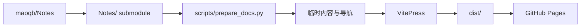

# Android Framework

Android / AOSP Framework 技术笔记站点。网站使用 [VitePress](https://vitepress.dev/) 构建，文章内容由独立的 [maoqb/Notes](https://github.com/maoqb/Notes) 仓库维护。

## 在线站点

[https://maoqb.github.io/aosp-docs/](https://maoqb.github.io/aosp-docs/)

## 构建结构

`Notes/` 是 Git submodule。构建前，`scripts/prepare_docs.py` 会扫描笔记仓库：

- 将 Markdown 与 `.drawdoc` 转换到临时的 VitePress 内容目录；
- 自动生成首页文章分组和多级侧栏，不需要维护固定导航；
- 原样发布 HTML 页面及其 CSS、JavaScript、图片等相对资源；
- 为旧版 MkDocs 的目录式文章地址生成兼容跳转页；
- 保留 Mermaid、draw.io、Excalidraw、mindmap 和图片宽度约定。



## 本地运行

首次克隆时初始化子模块：

```bash
git clone --recurse-submodules git@github.com:maoqb/aosp-docs.git
```

已经克隆的仓库可以执行：

```bash
git submodule update --init --recursive
```

安装依赖并启动开发服务器：

```bash
npm ci
make serve
```

访问 <http://127.0.0.1:5173/aosp-docs/>。

常用命令：

```bash
make build    # 构建生产站点到 dist/
make preview  # 构建并预览生产站点
make clean    # 清理所有生成目录
```

## 更新笔记

笔记应在 `maoqb/Notes` 仓库中提交并推送。Notes 仓库的 GitHub Actions 会更新本仓库记录的 submodule 版本，并触发博客重新部署。

```bash
git -C Notes add .
git -C Notes commit -m "Update notes"
git -C Notes push
```

## 部署

推送到 `main` 后，GitHub Actions 会安装 Node.js 依赖、生成文档、执行 VitePress 构建并发布到 GitHub Pages。整套托管不需要单独购买服务器。
